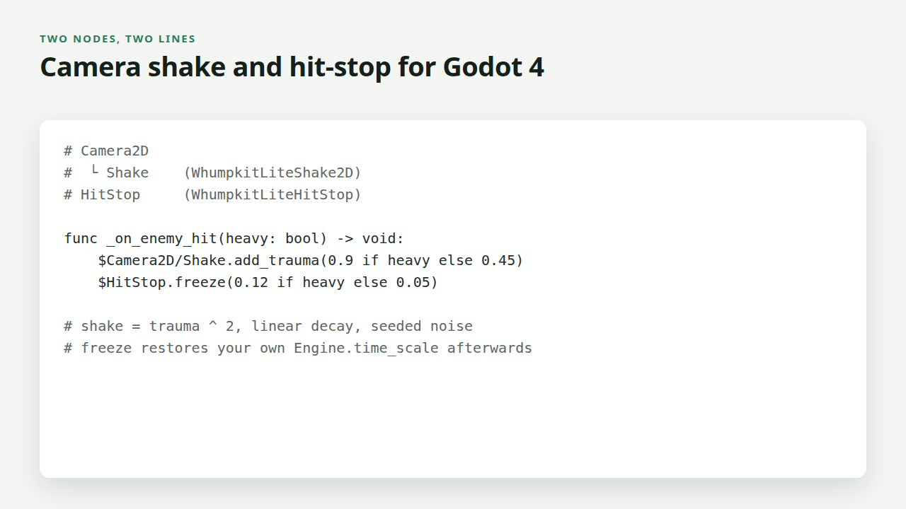

# Whumpkit Lite by PN Scripts

Free game feel helpers for Godot 4 (MIT): **trauma-based camera shake** for 2D
and 3D and **hit-stop** (freeze frames). Each is a node you drop into a scene.

Whumpkit Lite was called Wallop Lite before version 2.0.0; it was renamed so that its name is clearly its own. See CHANGELOG.md for the old-to-new node names.




## Quick start

1. Copy `addons/whumpkit_lite` into your project (or install "Whumpkit Lite" from
   the Godot Asset Library) and enable **Whumpkit Lite** in Project Settings >
   Plugins.
2. Add a **WhumpkitLiteShake2D** (or 3D) node as a child of your camera and a
   **WhumpkitLiteHitStop** node anywhere in the scene.
3. On a hit: `$Camera2D/Shake.add_trauma(0.5)` and `$HitStop.freeze(0.06)`.
4. In 2D, turn off **Ignore Rotation** on the Camera2D if you want the roll.
   Godot turns it on for every new Camera2D, and then the view never turns, so
   only the offset shows. WhumpkitLiteShake2D warns in the scene dock and once in
   the Output when the roll is on but hidden; set `max_roll_degrees` to 0 for a
   shake without roll. Turning Ignore Rotation off also makes the view follow
   any rotation of the camera's parents, so keep such a camera on a node that
   does not spin with the player.

The demo (`demo/demo.tscn`, the project's main scene) does exactly this on a
punching bag, with meters for trauma and time scale: click, tap or press Space
for a hit, hold Shift (or put down a second finger) for a heavy one. It is
checked in a web export in Chrome (`make web-check`: the heavy hit takes the
time scale to 0 and back to 1, touch taps are not doubled by mouse emulation,
0 console errors); the GIF above is made from that run.

## Nodes

- **WhumpkitLiteShake2D / WhumpkitLiteShake3D**: trauma model (0 to 1, shake =
  trauma ^ power, linear decay), seeded `FastNoiseLite` offsets and roll, so
  the same seed always gives the same motion. Applied on top of the camera's
  own offset and rotation and removed afterwards, so your camera code keeps
  control. 3D uses `h_offset` / `v_offset` plus pitch, yaw and roll. Signal
  `settled`; `stop()` clears at once. `get_roll_warning()` (2D) says why the
  roll would not show, or returns an empty string.
- **WhumpkitLiteHitStop**: freezes or slows `Engine.time_scale` for a real-time
  duration, then restores whatever scale was there before (your own slow
  motion survives). Overlapping freezes extend to the longest one and use the
  lowest scale; `max_duration` caps stacking. Signals `started`, `finished`.
- Every node has `step(delta)`. By default they run themselves each frame on
  real time (so the shake keeps moving during hit-stop); switch off
  `auto_process` to drive them yourself. In Movie Maker mode they follow the
  recording clock.
- `WhumpkitLite.Shake2D`, `WhumpkitLite.Shake3D` and `WhumpkitLite.HitStop` are
  typed script handles for code.

The full edition, Whumpkit, adds squash and stretch, hit flash, knockback,
damage numbers and a one-call `impact()`; see
https://pnscripts.com/marketplace/godot-wallop. Lite is complete on its own.

## Update

Replace the `addons/whumpkit_lite` folder with the new one (from the Asset
Library or the latest release on GitHub) and reopen the project. Your scenes and
node settings stay as they are; `CHANGELOG.md` lists what changed.

## Tests

```
godot --headless --path . --import
godot --headless --path . -s tests/run_tests.gd    # 14 tests, fixed time steps
```

Tested with Godot 4.7.1. The repository ZIP that the Asset Library downloads
contains only `addons/whumpkit_lite`, `README.md` and `LICENSE.md`
(`.gitattributes` export-ignore).

## Licence

MIT. Copyright (c) 2026 ПН СКРИПТС ЕООД (PN Scripts).
